# DashDeck

*[English](presentation.md)*

Um pequeno ecrã tátil ao lado do ClockworkPi uConsole que mostra o que os rádios e o sistema estão a fazer. O ecrã principal fica livre para o trabalho a sério.
Hardware: Waveshare ESP32-C6-Touch-LCD-1.47 (320 × 172), ligado só por USB.

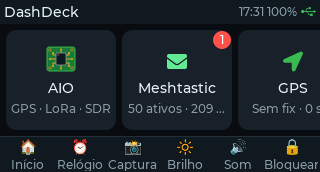

## Para que serve

Cada box abre uma função. Um swipe para o lado mostra as outras páginas e um toque num item abre o detalhe.

- **Rádios:** aviões (ADS-B) e navios (AIS) no mapa, com as rotas. Balões meteorológicos (radiossondas RS41) com o trajeto, o gráfico de altitude e o ponto onde rebentaram. Mensagens Meshtastic para ler e responder. O SDR é partilhado: ligar um receptor fecha os outros.
- **Hardware e sistema:** liga e desliga o GPS, o LoRa e o SDR da placa AIO v2 e mostra o consumo de cada um. CPU, temperatura e memória, serviços para ligar e parar, lançador de aplicações e as janelas abertas.
- **Relógio:** cinco mostradores com o tempo local, temporizador e alarme.
- **Avisos e mensagens do sistema:** avisos animados por cima de qualquer tela para mensagens diretas do Meshtastic, aviões em emergência (squawk 7700) e o alarme ou o temporizador. Mensagens curtas confirmam as ações ou avisam quando algo está ocupado.
- **Arranque:** enquanto o uConsole arranca, passa uma de duas animações em pixel art, com uma barra de progresso que fecha quando o uConsole responde.
- **Extras do dia a dia:** cotações de ações com o gráfico do dia, visor da câmara, rede e VPN, e botões rápidos para captura, brilho, volume e bloqueio.

| | |
|---|---|
| 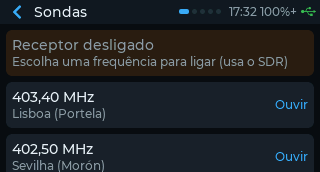 | 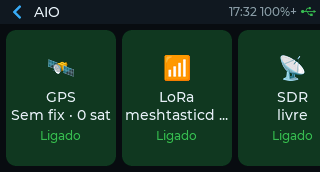 |
| 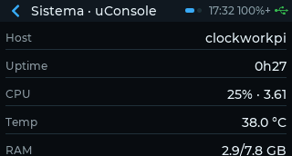 | 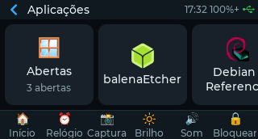 |
| 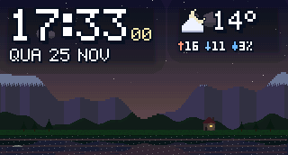 | 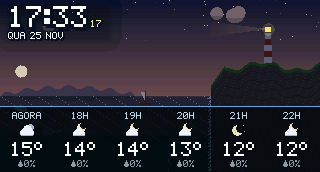 |
| 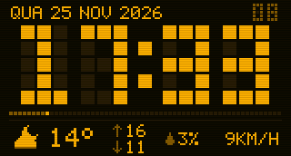 | 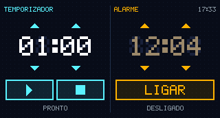 |
| 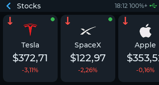 | 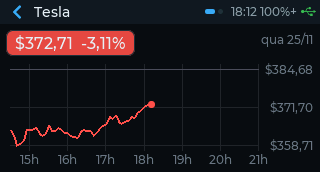 |
| 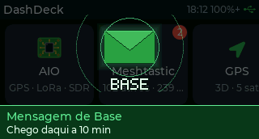 | 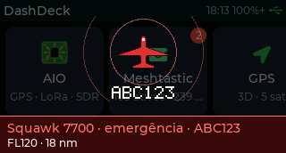 |
| 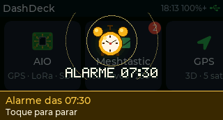 | 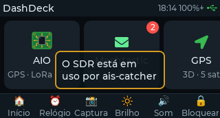 |
| 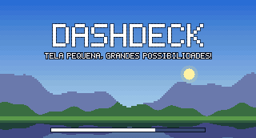 | 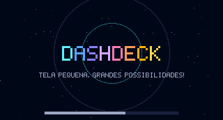 |

## Como funciona

- **O ESP32 só desenha.** O firmware é um renderizador LVGL fino, com modelos de tela, mapas, gráficos e animações em pixel art.
- **O uConsole decide.** Um daemon em Python, o `dashd`, monta cada tela e envia-a como uma linha JSON pela USB. Uma tela nova não precisa de firmware novo.
- **Um ficheiro de configuração.** Boxes, aplicações, serviços, frequências e ações ficam todos no `host/config.toml`.

As capturas foram tiradas do próprio aparelho (`kill -USR2` no dashd).
