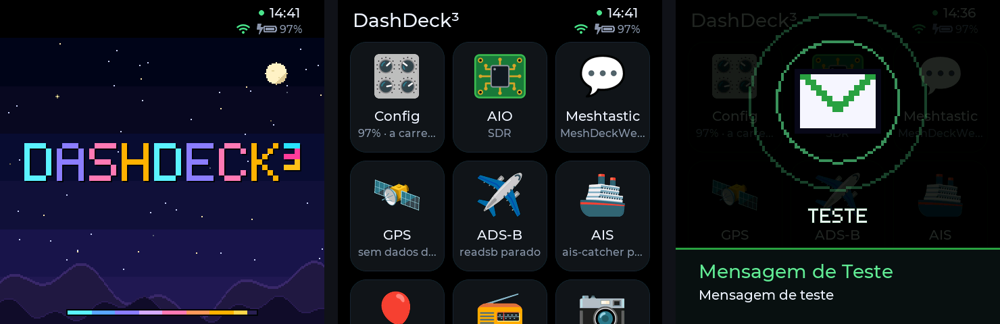

# DashDeck³

Um painel portátil para o ClockworkPi uConsole, numa
**Waveshare ESP32-S3-Touch-AMOLED-2.16** (cubo com ecrã AMOLED 480×480 tátil, bateria, altifalante,
dois microfones, IMU e três botões), ligado **por Wi-Fi** em vez de USB.



*(capturas do ecrã do cubo: arranque em pixel art de 8 bits, menu inicial e aviso)*

```
 uConsole                                            DashDeck³ (ESP32-S3, LVGL 9)
 ┌───────────────────────────────┐   WebSocket     ┌─────────────────────────────────┐
 │ deckd (Python, systemd user)  │ ◀════ Wi-Fi ═══▶│ só desenha telas genéricas      │
 │  config.toml → menus, ações   │   JSON + token  │ boxes com ícones · pixel art    │
 │  providers → dados ao vivo    │                 │ toque · botões · IMU · som · mic│
 │  avahi: _deck3._tcp (mDNS)    │ ◀─ USB (reserva │ bateria (AXP2101) · OTA         │
 └───────────────────────────────┘    e configurar)└─────────────────────────────────┘
```

Como no DashDeck, o aparelho **não guarda lógica**: menus, dados e ações vivem no `deckd`. O
protocolo é o mesmo (com extensões), para os módulos do DashDeck se portarem quase sem mudanças.

## Estado

**Preparado antes de a placa chegar** (25/11/2026): firmware 0.1.0 compila, deckd testado com um
aparelho simulado. Nada foi ainda corrido no hardware: ver a lista de verificação em
[docs/instalacao.md](docs/instalacao.md).

| Parte | Estado |
|---|---|
| Firmware: ecrã, toque, telas `menu` `list` `kv` `text`, botões, confirmações, avisos | compila |
| Pixel art de 8 bits (arranque, avisos, "Sobre", fora de casa) | a funcionar no cubo |
| Wi-Fi (8 redes), mDNS, WebSocket com token, USB de reserva | compila |
| Bateria/PWR (AXP2101), botões BOOT/IO18, IMU (face, agitar; girado à direita em pé abre o Pomodoro), som, microfone, OTA | compila |
| deckd: navegação, providers Sistema e DashDeck³, botões configuráveis, OTA, deckctl | testado com o fakedeck |
| Templates `plot`, `log`, emojis; módulos do DashDeck (Meshtastic, ADS-B, ...) | por portar |

## Arranque rápido

```bash
firmware/flash.sh            # compila e grava pela USB (a 1.ª vez)
setup/install.sh             # deckd + mDNS + udev
setup/provision.py --current # Wi-Fi e token pela USB
firmware/flash.sh ota        # depois: atualizar pelo Wi-Fi
host/fakedeck.py             # testar o deckd sem a placa
```

## Documentação

| Documento | Conteúdo |
|---|---|
| [docs/instalacao.md](docs/instalacao.md) | O que já está instalado, o dia 1 com a placa, verificação do hardware, comandos |
| [docs/protocolo.md](docs/protocolo.md) | Transportes, descoberta, mensagens e templates |
| [docs/arquitetura.md](docs/arquitetura.md) | Firmware, hardware e daemon |
| [docs/sugestoes.md](docs/sugestoes.md) | Upgrades dos módulos do DashDeck e funções novas |

## Licença
MIT. O motor e os providers do host (`host/engine.py`, `host/providers.py` e módulos de apoio) vieram do
DashDeck, do mesmo autor, e são mantidos aqui de forma independente. Montserrat: SIL Open Font License (`firmware/tools/fonts/OFL.txt`). BSP e componentes: os da Waveshare e da Espressif (Apache-2.0/MIT).
