# DashDeck

*[Português](apresentacao.md)*

A small touch screen that sits next to the ClockworkPi uConsole and shows what its radios and system are doing, so the main screen stays free for real work.
Hardware: Waveshare ESP32-C6-Touch-LCD-1.47 (320 × 172), connected by USB only.

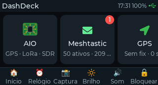

## What it's for

Each tile opens a function. Swipe sideways for its other pages, tap an item for details.

- **Radios:** aircraft (ADS-B) and ships (AIS) on a map with their routes. Weather balloons (RS41 radiosondes) with their track, altitude chart and burst point. A Meshtastic inbox where you can read and reply. The SDR is shared: starting one receiver closes the others.
- **Hardware and system:** turn the AIO v2 board's GPS, LoRa and SDR on or off and see what each one draws. Check CPU, temperature and memory, start and stop services, launch apps and switch between open windows.
- **Clock:** five clock faces with the local weather, plus a timer and an alarm.
- **Alerts and system messages:** animated alerts over any screen for direct Meshtastic messages, aircraft emergencies (squawk 7700) and the alarm or timer. Short messages confirm actions or warn when something is busy.
- **Startup:** while the uConsole boots, one of two pixel-art animations plays, with a progress bar that closes when the uConsole answers.
- **Everyday extras:** stock quotes with the day's chart, a camera viewfinder, network and VPN, and quick buttons for screenshot, brightness, volume and lock.

| | |
|---|---|
| 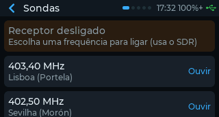 | 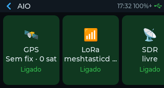 |
| 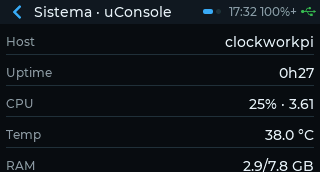 | 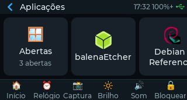 |
| 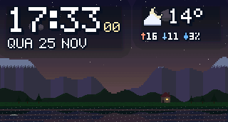 | 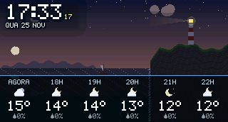 |
| 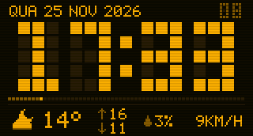 | 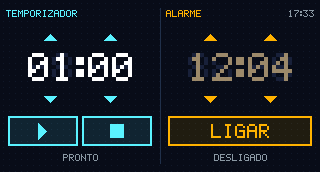 |
| 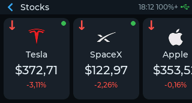 | 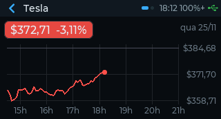 |
| 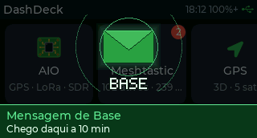 | 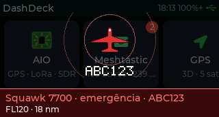 |
| 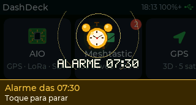 | 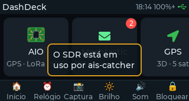 |
| 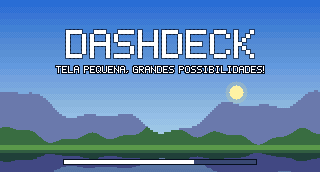 | 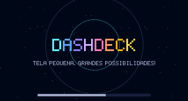 |

## How it works

- **The ESP32 only draws.** The firmware is a thin LVGL renderer with screen templates, maps, charts and pixel-art animations.
- **The uConsole decides.** A Python daemon, `dashd`, builds every screen and sends it as one JSON line over USB. A new screen needs no new firmware.
- **One config file.** Tiles, apps, services, frequencies and stocks all live in `host/config.toml`.

The captures come from the device itself (`kill -USR2` on dashd).
